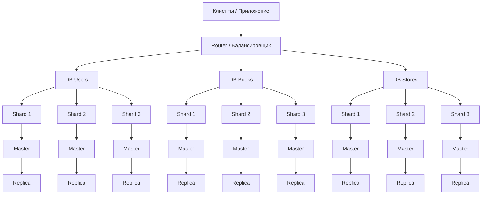
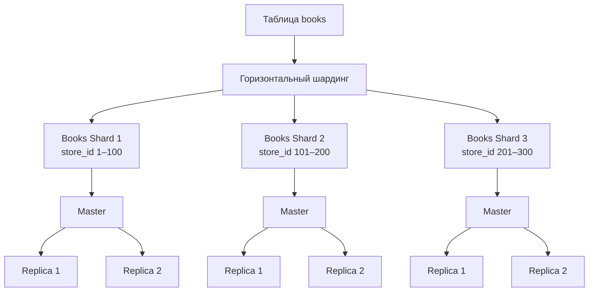

# Домашнее задание к занятию “Репликация и масштабирование. Часть 2” - Живова Е.М

---

### Задание 1

Активный Master-сервер и пассивный репликационный Slave-сервер
В этой схеме один сервер является основным — Master, а второй сервер является его репликой — Slave.
Master принимает операции записи и изменения данных. Slave получает копию данных с Master и может использоваться преимущественно для операций чтения.
Основные преимущества такой схемы:
- отказоустойчивость — при выходе Master из строя имеется копия данных на Slave;
- распределение нагрузки — часть запросов на чтение можно перенести на Slave;
- резервирование данных — данные хранятся на двух серверах;
- возможность восстановления — Slave можно использовать для восстановления работы системы после сбоя Master.
Главное ограничение такой схемы заключается в том, что нагрузка на чтение может быть распределена только между одним основным сервером и одной репликой.
Master-сервер и несколько Slave-серверов
В этой схеме один Master передаёт данные нескольким Slave-серверам. Master остаётся основным сервером для операций записи, а запросы на чтение можно распределять между несколькими репликами.
Основные преимущества:
- масштабирование чтения — большое количество запросов на чтение можно распределить между несколькими Slave;
- снижение нагрузки на Master — Master в большей степени занимается операциями записи;
- повышение отказоустойчивости — если одна из реплик выходит из строя, остальные продолжают работать;
- возможность увеличения производительности — при росте количества запросов можно добавить дополнительные реплики;
- разделение нагрузки — разные реплики можно использовать для разных задач, например для обычных запросов, аналитики или резервного копирования.
Таким образом, схема с одним Master и одним Slave подходит для относительно небольшой нагрузки и обеспечивает базовую отказоустойчивость. Схема с несколькими Slave позволяет эффективнее масштабировать операции чтения и подходит для систем с большим количеством запросов.

---

### Задание 2

Необходимо разработать систему хранения для базы данных, состоящей из трёх таблиц: users, books и stores.
Принцип построения системы
Для масштабирования базы данных используется комбинация вертикального и горизонтального шардинга.
Вертикальный шардинг используется для разделения таблиц между разными базами данных:
- DB Users — таблица users;
- DB Books — таблица books;
- DB Stores — таблица stores.

Такой подход позволяет распределить нагрузку между несколькими серверами и уменьшить объём данных, обрабатываемых каждым сервером.
Горизонтальный шардинг применяется внутри отдельных таблиц. Одинаковые по структуре данные разделяются между несколькими шардами.
Для таблицы users используется разделение по диапазону user_id.
Для таблицы books используется разделение по store_id. Благодаря этому книги, относящиеся к определённым магазинам, хранятся на соответствующем шарде. Например, книги магазинов с store_id от 1 до 100 находятся на первом шарде.
Для таблицы stores можно использовать разделение по регионам. Например, магазины Европы, Азии и Америки находятся на разных шардах.

Пример горизонтального шардинга таблицы. 
Книги распределяются по store_id, поэтому запрос к книгам конкретного магазина можно направить непосредственно на нужный shard.

Режимы работы серверов
Каждый shard работает по схеме Master — Replica.
- Master — основной сервер шарда, принимает операции записи (INSERT, UPDATE, DELETE) и может выполнять операции чтения.
- Replica — реплика основного сервера, получает изменения от Master и преимущественно используется для операций чтения.
- Router / балансировщик определяет, на какой shard необходимо направить запрос. Запросы на чтение при необходимости могут распределяться между репликами.
- При отказе Master одна из реплик может быть назначена новым основным сервером.
Таким образом, вертикальный шардинг распределяет таблицы между базами данных, горизонтальный шардинг распределяет строки таблиц между шардами, а репликация создаёт копии данных для повышения отказоустойчивости и масштабирования операций чтения.
